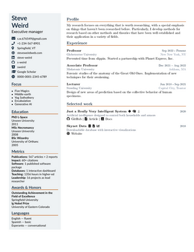
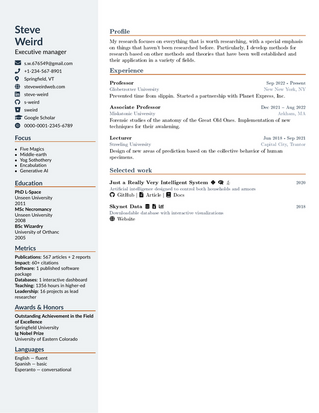

# CVSidebar - A latex template for a CV with a sidebar

This is a LaTex template for a CV with a sidebar displaying general information. Entries are designed to take key-value pairs.

|            |                 |
|:----------:|:---------------:|
|

### File structure

```
CVAcademic/
├── cvsidebar.cls         # Class file - contains definitions
├── main.tex              # Master document - sections are included from here
├── sidebar.tex           # Personal information, socials, awards and honors
├── experience.tex        # Work experience and positions
├── profile.tex           # Summary and interests
├── workx.tex             # Selected works
├── Example/              # Example PDF and PNG
│   ├── main_box.png
│   ├── main_box.pdf
│   ├── main_fullsb.png
│   └── main_fullsb.pdf
├── README.md             # This file
└── LICENSE               # License file
```

### Installation

Just donwload the template from https://guthub.com/toni-am/cvsidebar

You will probably also need TeXLive or MiKTeX for some of the package
requirements (see the `cls` file for a full list of required packages).

### Usage

Edit each of the `tex` files and include your information.
Request a full-page sidebar with the optional argument `fullpagesb`.
Add new entries using the `cventry` command
command (see below). Add or remove
sections by editing the `main.tex` file.
Add section and subsection
titles using the `cvsection` command, see below.
When done, compile with

```bash
pdflatex main.tex
pdflatex main.tex
```

## Customization

### Colors

Default colors are defined in the `cls` file (modify as needed):

```latex
\definecolor{cvdeep}{HTML}{213547}
\definecolor{cvsecondary}{HTML}{4A5568}
\definecolor{cvaccent}{HTML}{C56B2C}
\definecolor{cvlight}{HTML}{718096}
\definecolor{cvrail}{HTML}{EEF2F4}
```

### Margins and sizes

Default margins and layout size are defined in the `cls` (modify as needed). They can be overriden using a `\geometry` command with new parameter values
in the `main.tex` file


## New commands

The `cls` file defines new commands for CV entries, publications, and section and subsection
titles.

### Sections

The new `cvsection` command takes one mandatory argument:

```latex
\cvsection{title}
   title : section title
```

### Lines

The new `cvlines` command takes one mandatory argument, a comma-separated list of items to display ( one item per line):

```latex
\cvlines{a, b, c}
   a : item in first line
   b : item in second line
   c : item in third line
```
### Header

This will be displayed at the top of the sidebar.

```latex
\cvheader{
   name     = your name (large, with a thin rule under it)
   tagline  = your current title, position, etc.
 }
```
### Contact information

Contact information to be displayed in the sidebar. All keys are optional. Each line will be
preceeded by its icon:

```latex
\cvcontact{
   email     = address
   phone     = phone number
   location  = free text
   website   = given without https://
   linkedin  = profile id (linkedin.com/in/<id>)
   github    = user name
   bitbucket = user name
   scholar   = Google Scholar user id
   orcid     = ORCID id (0000-0000-0000-0000
}
```

### Entry

The `cls` class defines a general use `cventry` command, which displays the title in bold,
the subtitle in regular font, and the location and dates on the top right separated by a
`|` character. Even in long multiline title, the `date|location` data is displayed at the
top right of the entry. All keys are optional.

```latex
\cventry{
  title       = First line in bold
  subtitle    = Second line in normal text
  body        = Line in grey
  bodytwo     = Second line in grey
  date        = Can be single date or range (e.g. 2020 -- 2021}
  dates       = Same as date (alias)
  location    = Location, appears after date as date|location top right
  lefticons   = List of names of fontawesome5 icons to appear left of title
  righticons  = List of names of fontawesome5 icons to appear right of title
  github      = Link to github, appears as icon at the bottom
  bitbucket   = Link to bitbucket, appears as icon at the bottom
  website     = Link to website, appears as icon at the bottom
  docs        = Link to documentation, appears as icon at the bottom
  article     = Link to published article, appears as icon at the bottom
  items       = Last line, in regular font (accepts TeX commands like itemize, etc.)
}
```

## License

This software is distributed under a MIT license.
